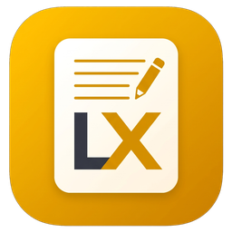
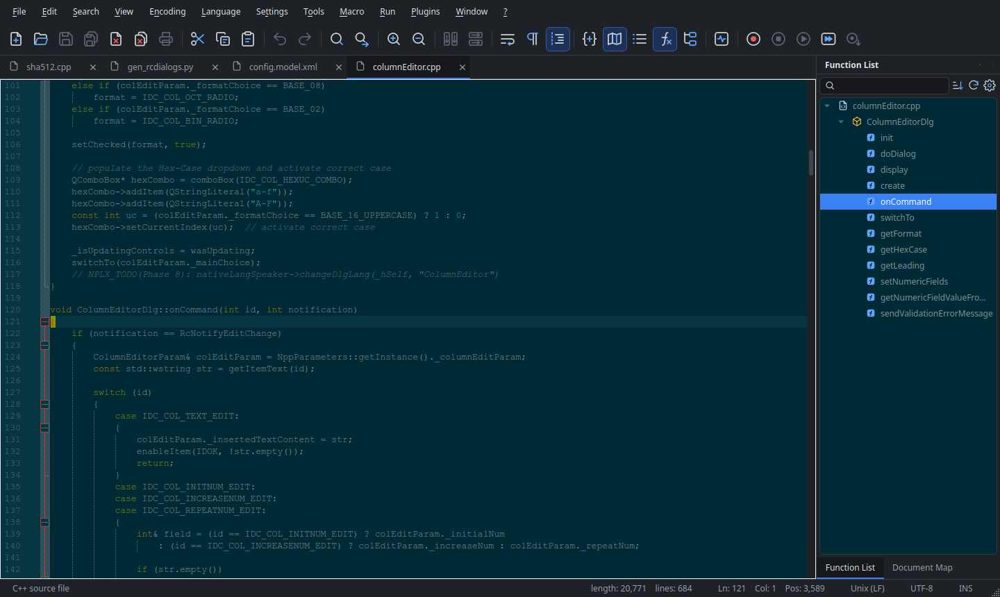
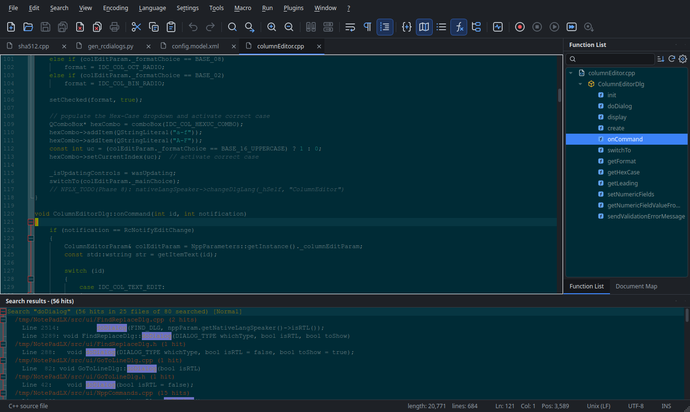
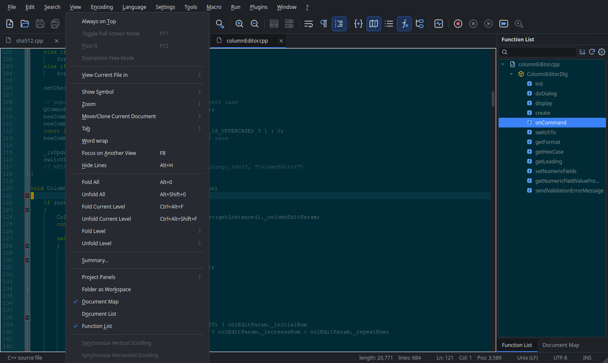
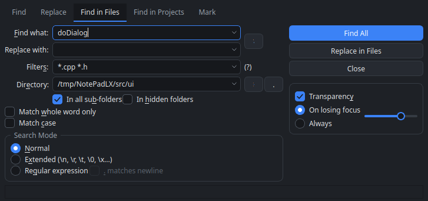
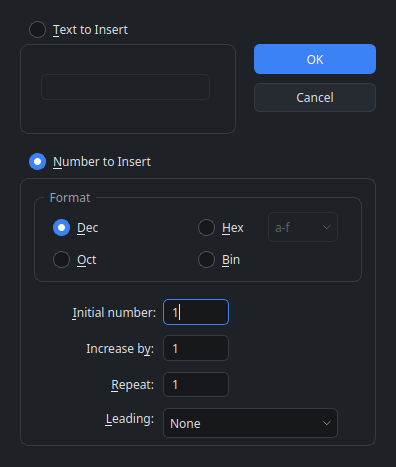
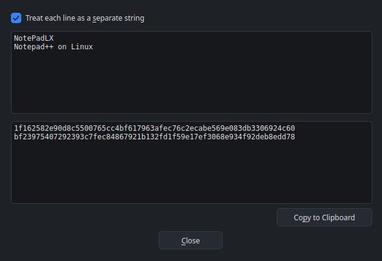
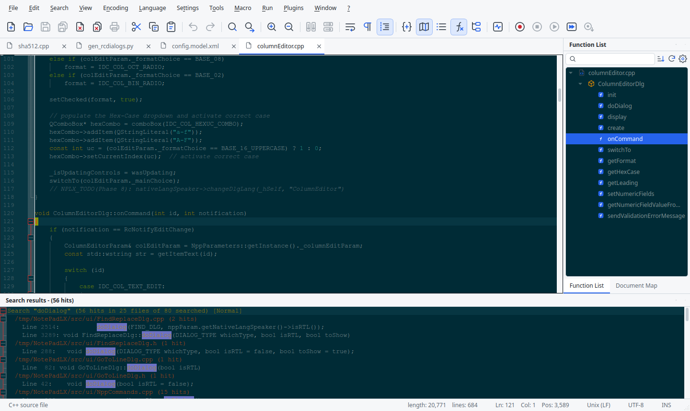

<div align="center">



# NotePadLX

**Notepad++, ported to Linux.**

A native Qt 6 source code editor built from the Notepad++ sources, with the same Scintilla editing engine, the
same languages and themes, and Notepad++-compatible configuration files.

[](https://github.com/ClaudiuJitea/NotePadLX/releases)
[](LICENSE)
[](https://www.qt.io/)
[](#install)



</div>

## Why NotePadLX

Notepad++ is one of the most loved editors on Windows, but it only runs there. Ports and look-alikes exist, but
most of them re-implement it. NotePadLX takes the other route: it **ports the Notepad++ code itself** to Linux
and Qt 6, keeping its algorithms, its command IDs, and its `config.xml`, `stylers.xml`, `shortcuts.xml` and
`langs.xml` formats. Your Notepad++ themes, user defined languages, and macros work as they are.

## Features

| | |
|---|---|
| **Editing** | Scintilla 5 with multi-selection, column mode, folding, auto-completion, brace matching, smart highlighting, bookmarks, line operations, case conversion, comment/uncomment |
| **Languages** | Syntax highlighting for 80+ languages through Lexilla, plus **User Defined Languages** with the UDL editor |
| **Themes** | All the Notepad++ themes and the Style Configurator. Default: dark interface with **Solarized** |
| **Search** | Find, Replace, Mark, **Find in Files**, Find in Projects, the Finder results panel, Boost regular expressions |
| **Panels** | Function List, Document Map, Document List, Folder as Workspace, Project Panels, Character Panel, Clipboard History |
| **Automation** | **Macro** recording, playback, saving and multiple runs. The **Run** menu with Notepad++ variables like `$(FULL_CURRENT_PATH)`. The **Shortcut Mapper** for every command, macro and editor key |
| **Tools** | **Column Editor** (text or numbers, dec/hex/oct/bin), **MD5 / SHA-1 / SHA-256 / SHA-512** from text, files or the selection |
| **Files** | Sessions and session snapshots, file monitoring (tail -f), encodings and EOL conversion, recent files, move to trash |
| **Desktop** | Single instance, `.desktop` integration, Wayland and X11, the desktop's file manager and terminal |

<table>
  <tr>
    <td width="50%"></td>
    <td width="50%"></td>
  </tr>
  <tr>
    <td align="center"><b>Find in Files</b> with the Finder results panel</td>
    <td align="center">Menus organised the Notepad++ way</td>
  </tr>
</table>

<table>
  <tr>
    <td width="40%"></td>
    <td width="30%"></td>
    <td width="30%"></td>
  </tr>
  <tr>
    <td align="center">Find / Replace / Find in Files</td>
    <td align="center">Column Editor</td>
    <td align="center">SHA-256 generator</td>
  </tr>
</table>

Prefer a light interface? Set `NPLX_THEME=light` (the editor keeps its own theme):



## Install

Download from the [Releases](https://github.com/ClaudiuJitea/NotePadLX/releases) page.

### AppImage (any distribution)

```sh
chmod +x NotePadLX-0.2-x86_64.AppImage
./NotePadLX-0.2-x86_64.AppImage
```

The AppImage bundles Qt and the other libraries. It needs an x86_64 system with glibc 2.43 or newer (the
packages are built on Ubuntu 26.04). On an older distribution, [build from source](#build-from-source).

### Debian / Ubuntu (.deb)

```sh
sudo apt install ./notepadlx_0.2_amd64.deb
```

This installs `notepadlx` in `/usr/bin`, the menu entry, the icons, the man page, and the default settings in
`/usr/share/notepadlx`. It uses the system's Qt 6. The package is built for Ubuntu 26.04 (Qt 6.10). On other
releases, [build from source](#build-from-source): it builds with Qt 6.5 or newer.

Your settings live in `~/.config/notepadlx/`, in the Notepad++ formats. To bring over your Notepad++ themes,
user defined languages or macros, copy the files from `%APPDATA%\Notepad++` on Windows.

## Build from source

```sh
# Ubuntu / Debian
sudo apt install build-essential cmake ninja-build qt6-base-dev qt6-5compat-dev qt6-svg-plugins libgl-dev
# Fedora
sudo dnf install gcc-c++ cmake ninja-build qt6-qtbase-devel qt6-qt5compat-devel qt6-qtsvg mesa-libGL-devel

cmake -S . -B build -G Ninja
cmake --build build
build/src/notepadlx            # runs from the build tree, no installation needed
cd build && ctest              # 15 test suites
```

Packages: `packaging/build-packages.sh` builds `dist/notepadlx_<version>_amd64.deb` and
`dist/NotePadLX-<version>-x86_64.AppImage`. Pass `deb` or `appimage` to build only one of them.

Scintilla, Lexilla, Boost.Regex, pugixml, nlohmann/json and uchardet are in `third_party/`, so there are no other
dependencies.

## Project status

NotePadLX 0.2 adds the Shortcut Mapper to the first public version (0.1). The port follows a [10-phase plan](PROMPT.md); detailed progress is
in [PORTING_STATUS.md](PORTING_STATUS.md).

| Phase | | Status |
|---|---|---|
| 0 | Bootstrap: CMake, vendored Scintilla / Lexilla / Boost.Regex | ✅ Done |
| 1 | Portable core: parameters, encodings, file I/O, sessions | ✅ Done |
| 2 | Main window: menus, toolbar, tabs, split views, context menus | ✅ Mostly done (365 commands ported) |
| 3 | Files, sessions, monitoring | ✅ Mostly done (Load/Save Session dialogs pending) |
| 4 | Find / Replace, Find in Files, Mark, the Finder | ✅ Mostly done (incremental search pending) |
| 5 | Languages, themes, Style Configurator, User Defined Languages | ✅ Done |
| 6 | Docking panels | ✅ Done |
| 7 | Dialogs and tools: macros, Run, Column Editor, hashes, Shortcut Mapper ✅; Preferences next | 🚧 In progress |
| 8 | Printing, full screen and distraction free, localization, About / Debug Info | ⏳ Planned |
| 9 | Plugin API for Linux (`.so` plugins with the Notepad++ messages) | ⏳ Planned |
| 10 | Packaging: `.deb` and AppImage ✅; Flatpak, `.rpm`, CI next | 🚧 In progress |

Commands that are not ported yet appear greyed out with the tooltip *"Not yet ported to NotePadLX"*. Windows-only
features such as the WinGUp updater, PowerShell and the Windows registry are removed.

## How it is built

- **Qt 6 Widgets** for the interface, with Scintilla's official Qt backend (`ScintillaEditBase`).
- **The Notepad++ code is ported, not rewritten.** Upstream algorithms keep their names and their `IDM_*` command
  IDs. Every Linux-specific change is marked `// NPLX:` in the code.
- **The Notepad++ dialogs come from its own `.rc` files.** `tools/gen_rcdialogs.py` turns the resource scripts into
  tables, and `RcDialog` builds the Qt dialogs from them, so the layouts match upstream.
- **NotePadLX look:** an icon set drawn for light and dark, a Fusion-based style, and the Solarized default theme.

## Contributing

Bug reports and pull requests are welcome on [GitHub](https://github.com/ClaudiuJitea/NotePadLX/issues). Please
follow the porting rules in [PROMPT.md](PROMPT.md): port upstream code instead of paraphrasing it, mark Linux
changes with `// NPLX:`, and add a test for each ported feature.

## License and credits

NotePadLX is free software under the [GNU General Public License v3](LICENSE).

It is a port of [Notepad++](https://notepad-plus-plus.org/) by Don HO and the Notepad++ contributors, and builds
on [Scintilla and Lexilla](https://www.scintilla.org/) by Neil Hodgson,
[Boost.Regex](https://www.boost.org/), [pugixml](https://pugixml.org/),
[nlohmann/json](https://github.com/nlohmann/json), and [uchardet](https://www.freedesktop.org/wiki/Software/uchardet/).
NotePadLX is not affiliated with the Notepad++ project.
